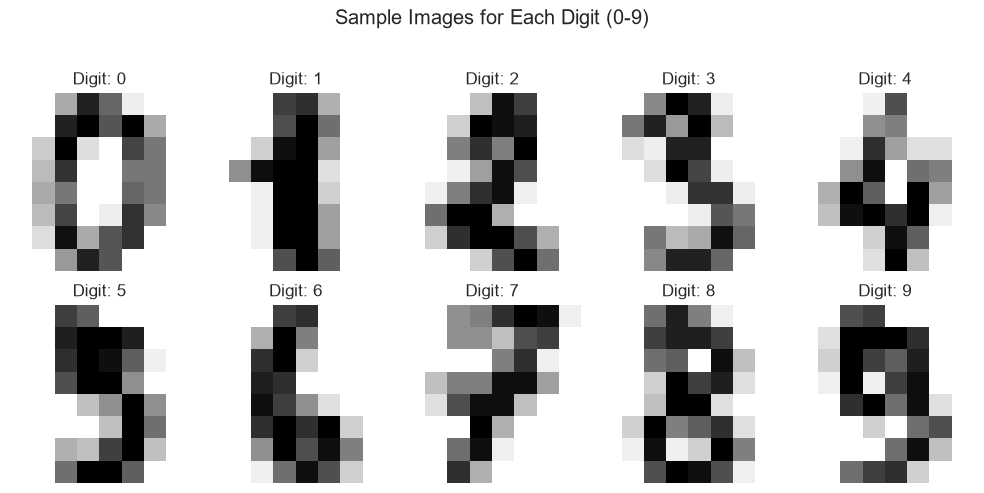
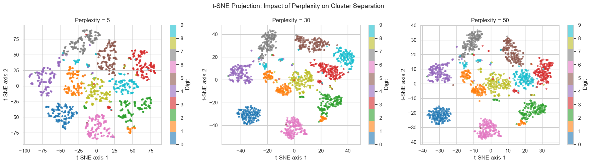
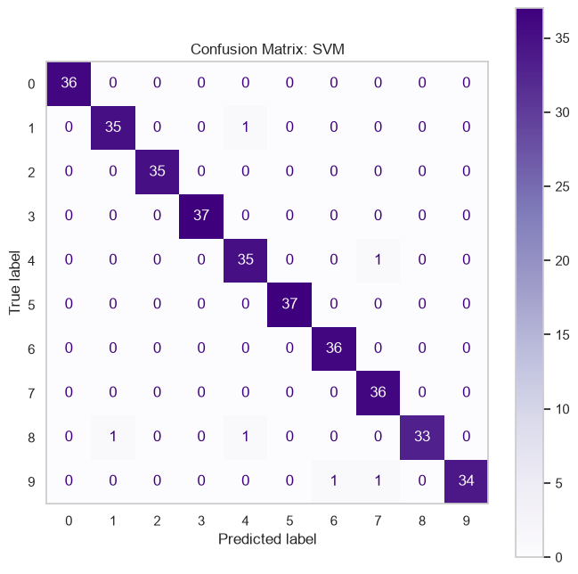
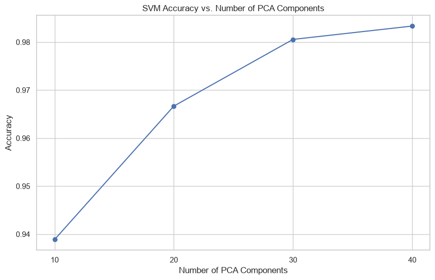

# Handwritten Digit Recognition: From Hidden Structure to Prediction

End-to-end machine learning project on the scikit-learn **Digits** dataset (1,797 handwritten 8×8 images, 10 classes). It combines **unsupervised learning** (to find out whether the digits form natural groups without labels) with **supervised learning** (to predict them), and then connects the two.

Final project for *Machine Learning* (AI Engineering, TECNUN – University of Navarra, 2025-26).
**Authors:** Aitor Marcalain & Eneko Iza



## Research questions

1. **Unsupervised:** is there latent structure in pixel space that separates the digits *without* using labels?
2. **Supervised:** how accurately can we predict the digit, and which model works best?
3. **Connection:** does the unsupervised analysis help us improve or understand the classifiers?

## Approach

| Stage | What we did |
|---|---|
| Data understanding | Missing values, class balance (≈180 samples/class), pixel distribution, stratified 80/20 split |
| Dimensionality reduction | PCA (explained variance, 2D projection) and t-SNE (perplexity 5 / 30 / 50) |
| Clustering | K-Means (elbow method, k = 10) and Agglomerative (Ward) on the original and PCA spaces, plus a dendrogram |
| Classification | Logistic Regression, KNN and SVM (RBF), each tuned with `GridSearchCV` inside a `Pipeline` (scaler → model) to avoid leakage |
| Evaluation | Held-out test set: classification reports, confusion matrices, error analysis |
| Connection | SVM on PCA features, cluster labels as an extra feature, misclassified points on the t-SNE map |

## Key results

### Unsupervised
- **31 principal components** keep 90 % of the variance and **40** keep 95 %.
- **t-SNE separates the 10 digits far better than PCA**: most classes form clean, isolated clusters.
- Silhouette score (k = 10): K-Means 0.139 / Agglomerative 0.125 in the 64-D space, and 0.378 / 0.311 in 2-D PCA space. *Silhouette values from spaces with different dimensions are not directly comparable.*



### Supervised (test set, 360 images)

| Model | Best hyperparameters | CV accuracy | **Test accuracy** | F1 (weighted) |
|---|---|---|---|---|
| **SVM (RBF)** | C = 100, γ = 0.01 | 0.983 | **0.983** | 0.983 |
| Logistic Regression | C = 1, solver = saga | 0.971 | 0.972 | 0.972 |
| KNN | k = 5 | 0.975 | 0.964 | 0.964 |

<p align="center"></p>

### Connecting both parts
- **PCA + SVM:** accuracy rises from 0.939 (10 components) to 0.983 (40 components). With 40 components, the 64 → 40 compression costs **no accuracy at all**.
- **Cluster label as an extra feature:** it does not help (Logistic Regression goes from 0.972 to 0.969), because the cluster information is already contained in the pixels.
- **Error analysis:** the SVM misclassifies only **6 of 360** test images (8→1, 8→4, 9→6, 9→7, 4→7, 1→4). The notebook places them on the t-SNE map and shows them as images.



## Run it

```bash
git clone https://github.com/amarcalainm-oss/digit-recognition-unsupervised-supervised.git
cd digit-recognition-unsupervised-supervised
python -m venv .venv
.venv\Scripts\activate          # Windows  (Linux/macOS: source .venv/bin/activate)
pip install -r requirements.txt
jupyter notebook notebooks/digits_unsupervised_to_supervised.ipynb
```

The dataset is built into scikit-learn (`load_digits`), so nothing needs to be downloaded. Tested with Python 3.14 and scikit-learn 1.9.

## Tech stack

Python · NumPy · pandas · scikit-learn · SciPy · Matplotlib · Seaborn · Jupyter
